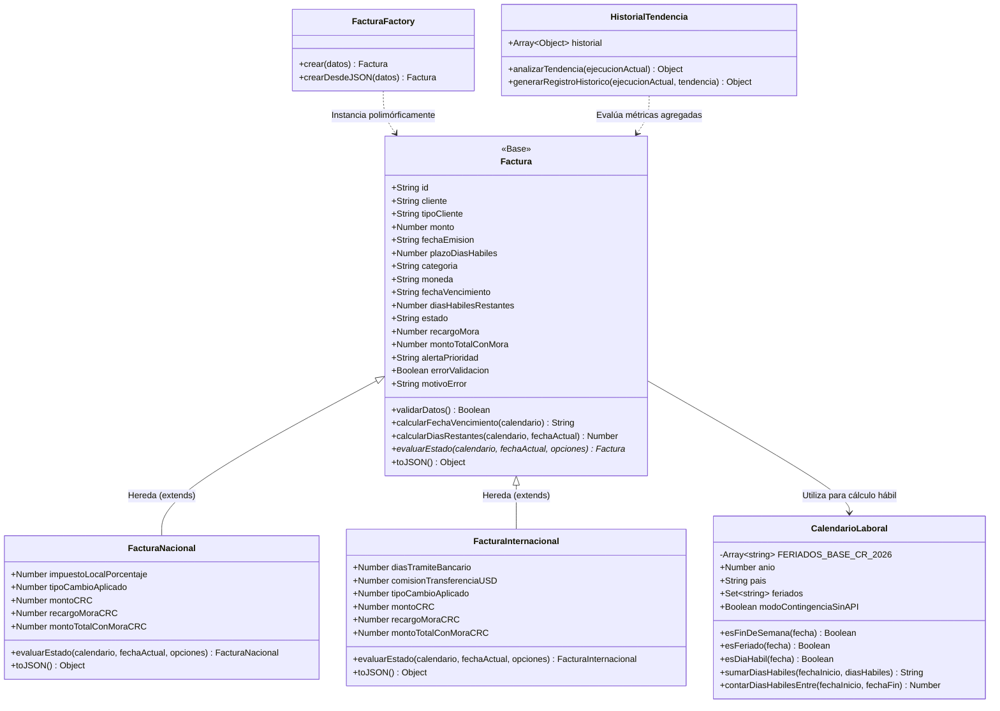
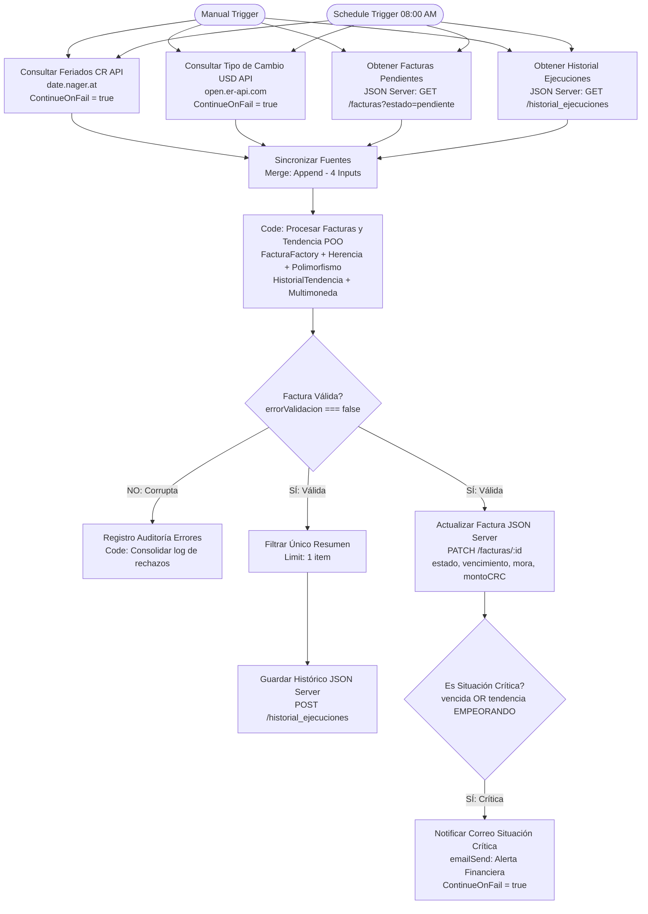

# Documento de Lógica de Negocio y Arquitectura de Software
## Laboratorio #1 + Extensión: Soluciones de Negocio (POO + n8n)
### Escenario 1: Central de Facturación con Días Hábiles, Multimoneda y Tendencias

---

## 1. Visión General y Objetivos de la Extensión

La solución base resuelve el cálculo de fechas de vencimiento en días hábiles omitiendo fines de semana y feriados de Costa Rica (`date.nager.at`). La **Extensión del Laboratorio** eleva la solución a un nivel empresarial integrando cuatro retos de arquitectura avanzada:

1. **Reto 1 (Herencia y Polimorfismo):** Jerarquía de clases con `Factura` como clase base y subclases concretas `FacturaNacional` (moneda CRC, reglas tributarias locales) y `FacturaInternacional` (moneda USD, días de compensación bancaria internacional SWIFT, tarifas administrativas y conversión cambiaria).
2. **Reto 2 (Segunda Fuente Externa y Nodo Merge):** Integración con la API pública y en tiempo real de tipo de cambio `https://open.er-api.com/v6/latest/USD`, sincronizando cuatro fuentes de datos simultáneas mediante un nodo `Merge` cuádruple en n8n.
3. **Reto 3 (Notificación Automática por Correo ante Situación Crítica):** Alerta automática vía nodo `emailSend` activada cuando una factura cae en morosidad o la tendencia general de la cartera está `"EMPEORANDO"`.
4. **Reto 4 (Historial y Análisis de Tendencia Financiera):** Clase `HistorialTendencia` que contrasta las métricas del corte actual contra el histórico registrado en JSON Server (`/historial_ejecuciones`), determinando diagnósticos de `"MEJORANDO"`, `"EMPEORANDO"` o `"ESTABLE"`, y persistiendo el nuevo corte.

---

## 2. Jerarquía de Clases y Polimorfismo (Reto 1)

### 2.1. Diagrama de Clases UML (Mermaid)

### 2.2. Polimorfismo en el Método `evaluarEstado()`

El polimorfismo se manifiesta cuando el cliente (o el orquestador del nodo `Code`) invoca el mismo método `factura.evaluarEstado(calendario, fechaActual, { tipoCambio })` sobre una colección heterogénea de facturas y cada subclase ejecuta una lógica especializada:

| Aspecto de Negocio | `FacturaNacional` (Moneda CRC) | `FacturaInternacional` (Moneda USD) |
| :--- | :--- | :--- |
| **Plazo Efectivo** | Respeta el plazo contractual base (15 días Regular / 20 días VIP). | Suma **3 días hábiles adicionales** por trámites bancarios internacionales SWIFT (`plazoEfectivo = plazoBase + 3`). |
| **Cálculo de Mora** | Aplica tasa pura sobre colones (5% Regular / 2% VIP). | Aplica tasa sobre USD (5% Regular / 2% VIP) + **$25 USD de tarifa fija de transferencia bancaria**. |
| **Conversión de Moneda** | `tipoCambioAplicado = 1`, `montoCRC = monto`. | Convierte en tiempo real: `montoCRC = monto * tipoCambio`, `montoTotalConMoraCRC = totalUSD * tipoCambio`. |
| **Alertas de Prioridad** | `"ALTA - Próxima a vencer"` o `"VENCIDA - Cobro inmediato"`. | `"ALTA - Próxima a vencer (Internacional)"` o `"VENCIDA - Cobro internacional prioritario"`. |

---

## 3. Análisis de Historial y Tendencia Financiera (Reto 4)

La clase `HistorialTendencia` permite al sistema aprender de ejecuciones previas y no limitarse a una foto estática del día:

### 3.1. Criterios de Clasificación de Tendencia

$$\Delta = \text{PorcentajeMorosidad}_{\text{Actual}} - \text{PorcentajeMorosidad}_{\text{Previo}}$$

1. **`"EMPEORANDO"` (Alerta Crítica = True):**
   - Si $\Delta > +2.0\%$ o el monto total vencido aumentó más de un $15\%$ respecto al corte previo.
   - **Acción:** Dispara notificación automática por correo al departamento de cobranzas y dirección financiera.
2. **`"MEJORANDO"` (Alerta Crítica = False):**
   - Si $\Delta < -2.0\%$.
   - **Acción:** Registra tendencia positiva y optimización de cartera.
3. **`"ESTABLE"` (Alerta Crítica = False):**
   - Si $-2.0\% \le \Delta \le +2.0\%$.
   - **Acción:** Registra estabilidad en indicadores crediticios.

---

## 4. Arquitectura del Workflow en n8n con 4 Fuentes y Notificación (Reto 2 y 3)

---

## 5. Resumen de Pruebas y Validación

El conjunto de pruebas automatizadas en `test_runner.js` cubre 52 aserciones exhaustivas:
- **Bloque 1 (12 pruebas):** Métodos de `CalendarioLaboral` y cálculo de días hábiles.
- **Bloque 2 (11 pruebas):** 5 Reglas de Negocio base (RN1 a RN5).
- **Bloque 3 (13 pruebas):** Herencia, Polimorfismo en plazo, mora y moneda, y `FacturaFactory`.
- **Bloque 4 (7 pruebas):** Métodos de `HistorialTendencia` y diagnósticos de morosidad.
- **Bloque 5 (4 pruebas):** Situaciones de error (Error 1 y Error 2).
- **Bloque 6 (5 pruebas):** Integración del lote extendido de `db.json` con `ServicioFacturacion`.
